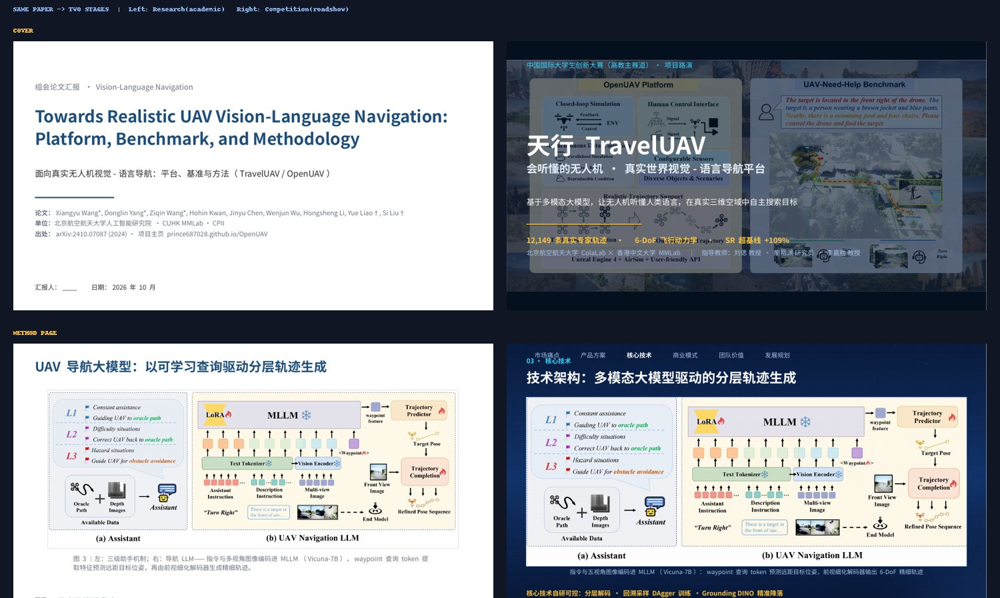

<div align="center">

# Paper2Podium · 从论文到领奖台

**一个 skill，两种登台：科研答辩 · 竞赛路演。**

Turn one paper into two stage-ready decks — academic defense & competition roadshow.

[模板展示](#-模板展示先看成品) · [亮点](#-亮点) · [快速开始](#-快速开始) · [实战演示](#-实战演示traveluav) · [技能一览](#-技能一览)

</div>

---

<p align="center">
  
</p>
<p align="center"><sub>同一篇论文的封面页与方法页：左为学术版（Nature/Science 克制风），右为竞演版（国赛深空科技蓝）</sub></p>

## 为什么是 Paper2Podium？

组会汇报、毕业答辩、挑战杯 / 国创赛路演——每个科研人都要「登台」，但多数人被 PPT 拖到凌晨。
Paper2Podium 是两个 AI 演示技能（skill）的集成套装：你说「把这篇论文做成答辩 PPT」或
「给项目做一套挑战杯路演」，它就完成 **读论文 → 精准抠图 → 排版设计 → 讲稿撰写** 全流程，
产出可直接登台的成品 deck，中英双语。

## 🏆 模板展示（先看成品）

以下模板由真实论文（[TravelUAV, arXiv:2410.07087](https://arxiv.org/abs/2410.07087)）全自动生成，
**点击 PDF 可在浏览器内直接翻页**，pptx 可下载拆开研究：

| 风格 | 在线翻页（PDF） | 模板文件（pptx） | 整体一览 |
|---|---|---|---|
| 🎓 科研版 · 14 页<br><sub>组会 / 答辩 · 白底学术蓝灰</sub> | [科研版_在线预览.pdf](showcase/decks/科研版_在线预览.pdf) | [TravelUAV_科研版组会汇报.pptx](showcase/decks/TravelUAV_科研版组会汇报.pptx) |  |
| 🚀 竞演版 · 17 页<br><sub>国创赛路演 · 深空科技蓝</sub> | [竞演版_在线预览.pdf](showcase/decks/竞演版_在线预览.pdf) | [TravelUAV_竞赛版路演.pptx](showcase/decks/TravelUAV_竞赛版路演.pptx) |  |

> 两版均内置每页 30–60 秒讲稿（演讲者备注 + 中英对照文档）；英文版可通过
> [`examples/TravelUAV/`](examples/TravelUAV/) 的构建脚本一键复现。

## ✨ 亮点

- **📄 论文图表精准提取**：caption 锚定算法（pdffigures2 同路线）定位 Figure/Fig/图/表，
  自动区分矢量图与位图，450 DPI 高清裁剪——框架图、实验曲线、消融表从 PDF「干净地」
  搬进幻灯片，不带一行正文。裁歪了？内置「整页预览 + 手动精裁」感知闭环兜底。
- **🎓 学术设计系统**：Nature/Science 克制风，Assertion-Evidence 排版（标题即论断句，
  图占 60–75%），三线表 + Okabe-Ito 色盲安全色板，学术图注规范。
- **🚀 竞演设计系统**：国赛路演风——深空科技蓝渐变星空背景、顶部章节导航、超大金色数字、
  TAM/SAM/SOM 市场嵌套、竞品矩阵 + 综合点评级、数据飞轮、风险预案；无图页自动补
  原生示意图。逐页版式原型不重样，无独立章节页，对标国创赛评审五维度。
- **🖼️ 自动配图**：星空背景离线生成（PIL 三种风格）；论文附录场景墙自动切块做场景卡。
- **🈶️ 中英双语 + 讲稿**：同一版式一键产出中/英双版，每页讲稿自动注入演讲者备注。
- **✅ 交付级 QA**：构建后渲染逐页 PNG，视觉模型逐页验收（溢出/重叠/变形/对比度）。

## 🚀 快速开始

面向支持 SKILL.md 格式的 AI 编码智能体（ZCode、Claude Code 等）：

```bash
git clone https://github.com/williamtymhuabian/paper2podium.git
# 用户级安装（所有项目可用）
cp -r paper2podium/skills/* ~/.zcode/skills/
# 或仅本项目可用
cp -r paper2podium/skills/* <your-project>/.zcode/skills/
```

依赖：`pip install PyMuPDF python-pptx pillow`；渲染 QA 需 LibreOffice + poppler。

装好后对 AI 说：

> 把 `paper.pdf` 做成 15 分钟组会汇报（学术版）
> 用挑战杯路演风格给我们项目做一套 PPT，深空科技蓝（竞演版）
> Make a thesis-defense deck from this paper, in English

技能内置叙事结构、逐页版式配方（含英寸级坐标）、避坑清单，AI 按谱施工而非自由发挥。

## 🎤 实战演示：TravelUAV

用 Paper2Podium 把同一篇无人机视觉-语言导航论文做成两套风格迥异的 deck：

<details open>
<summary><b>学术版（14 页 · Assertion-Evidence）</b></summary>

标题是论断句、框架图占版面 75%、每图重写口语化图注、数据全部标注来源；
叙事线：背景（漏斗式）→ 数据集对比 → 平台 → 基准 → 方法 → 实验 → 结论。

<p align="center"></p>
</details>

<details open>
<summary><b>竞演版（17 页 · 国创赛路演）</b></summary>

真实航拍主视觉封面、顶部章节导航、94.5% vs 2.27% 对比大数字、飞行序列演示、
TAM/SAM/SOM、竞品矩阵、数据飞轮、三年里程碑 + 风险预案——每页一种版式原型。

<p align="center"></p>
</details>

## 🧩 技能一览

| 技能 | 目录 | 触发词 | 产出 |
|---|---|---|---|
| **学术 research-ppt** | `skills/research-ppt/` | 科研PPT · 答辩 · 组会 · 论文汇报 · thesis defense | 白底学术风 deck + 图注规范 + 来源标注 |
| **竞演 competition-ppt** | `skills/competition-ppt/` | 竞赛PPT · 挑战杯 · 国创赛 · 路演 · roadshow | 深空科技蓝（红金/浅色变体）deck + 导航 + 大数字 + 商业页型 |

每个技能含 `SKILL.md`（工作流）+ `references/`（设计系统逐页配方）+ `scripts/`
（`extract_figures.py` 图表提取 / `make_backgrounds.py` 背景生成）。

## 🗺️ Roadmap

- [ ] 更多风格皮肤（红色党政风、浅色医疗风模板成品化）
- [ ] Beamer / LaTeX 学术版输出
- [ ] 答辩问答预测（基于论文自动生成评委 Q&A 备查页）

## 📜 许可

MIT（见 [LICENSE](LICENSE)）。演示案例中的论文图表版权归原论文作者所有，仅供展示。
如果 Paper2Podium 帮你登了台，欢迎来一个 Star ⭐ / 提 issue 交流。
