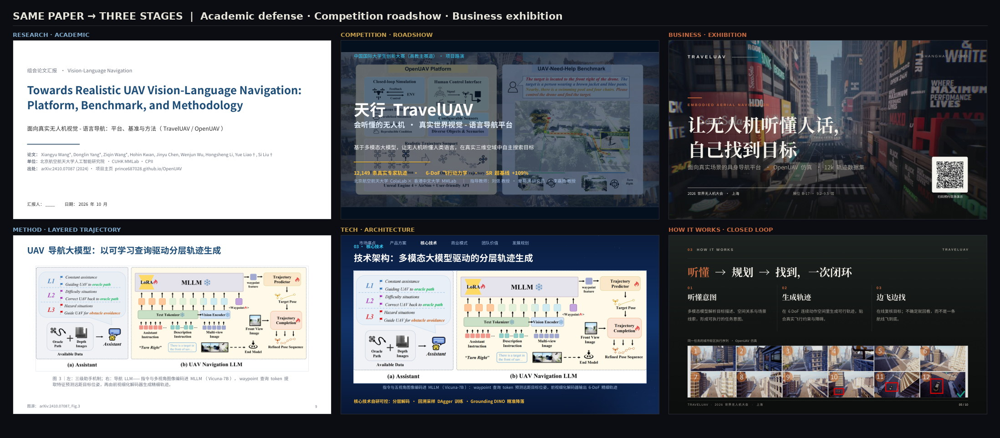
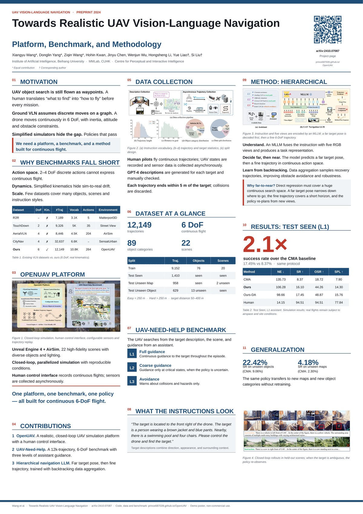
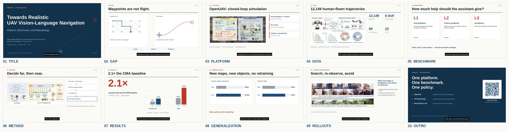
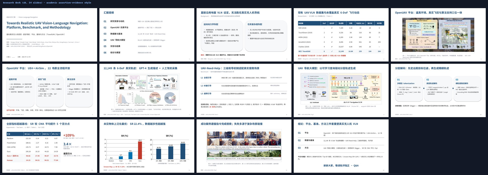
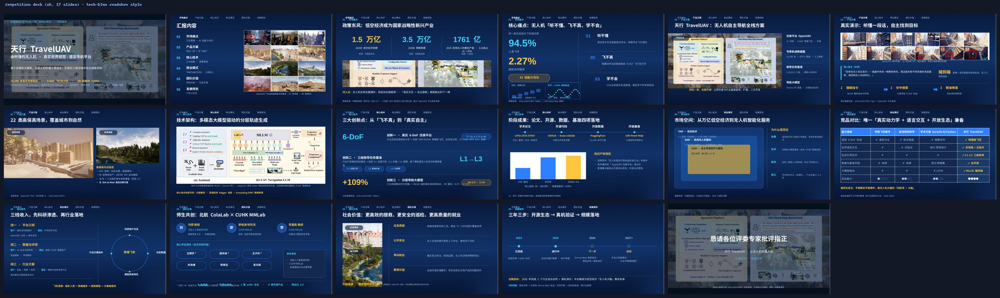
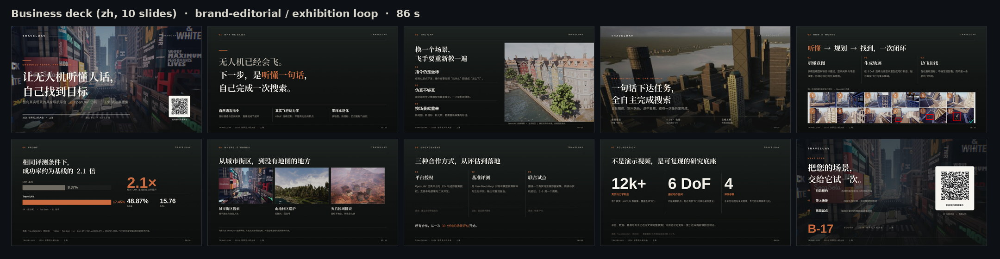

<div align="center">

# Paper2Podium · 从论文到领奖台

**一套技能，五种登台：科研答辩 · 竞赛路演 · 商业展出 · A0 海报 · 3 分钟宣传片。**

Turn one paper into five stage-ready assets — defense deck, roadshow, exhibition loop, A0 poster & 3-minute promo video.

[模板展示](#-模板展示先看成品) · [亮点](#-亮点) · [快速开始](#-快速开始) · [实战演示](#-实战演示traveluav) · [技能一览](#-技能一览)

</div>

---

<p align="center">
  
</p>
<p align="center"><sub>同一篇论文的三套封面与核心方法页：左为学术版（Nature/Science 克制风），中为竞演版（国赛深空科技蓝），右为商业版（品牌编辑风 · 展台循环）</sub></p>

<p align="center">
  
  
</p>
<p align="center"><sub>同一篇论文的 A0 三栏海报（左）与 3 分钟宣传片 10 段分镜（右）——海报可打印，视频可直接投会议宣传渠道</sub></p>

## 为什么是 Paper2Podium？

组会汇报、毕业答辩、挑战杯 / 国创赛路演、公司展台——每个科研人都要「登台」，但多数人被 PPT 拖到凌晨。
Paper2Podium 是三个 AI 演示技能（skill）的集成套装：你说「把这篇论文做成答辩 PPT」、
「给项目做一套挑战杯路演」、「给公司做一套展会循环大屏」，或「再做一张 A0 海报 / 一条 3 分钟宣传片」，
它就完成 **读论文 → 精准抠图 → 排版设计 → 讲稿撰写 → 展台循环 → 海报/视频** 全流程，
产出可直接登台的成品。学术/竞演版中英双语，商业版内置静音可读与自动轮播规范。

## 🏆 模板展示（先看成品）

以下模板由真实论文（[TravelUAV, arXiv:2410.07087](https://arxiv.org/abs/2410.07087)）全自动生成，
**点击 PDF 可在浏览器内直接翻页，视频可直接播放**，源文件可下载拆开研究：

| 产物 | 在线查看 | 源文件 / 脚本 | 整体一览 |
|---|---|---|---|
| 🎓 科研版 · 14 页<br><sub>组会 / 答辩 · 白底学术蓝灰</sub> | [科研版_在线预览.pdf](showcase/decks/科研版_在线预览.pdf) | [TravelUAV_科研版组会汇报.pptx](showcase/decks/TravelUAV_科研版组会汇报.pptx) |  |
| 🚀 竞演版 · 17 页<br><sub>国创赛路演 · 深空科技蓝</sub> | [竞演版_在线预览.pdf](showcase/decks/竞演版_在线预览.pdf) | [TravelUAV_竞赛版路演.pptx](showcase/decks/TravelUAV_竞赛版路演.pptx) |  |
| 🏛️ 商业版 · 10 页 / 86 秒循环<br><sub>展台大屏 · 品牌编辑风</sub> | [商业版_在线预览.pdf](showcase/decks/商业版_在线预览.pdf) | [TravelUAV_商业展台循环.pptx](showcase/decks/TravelUAV_商业展台循环.pptx) |  |
| 🖼️ A0 海报 · 1 页<br><sub>会议现场 · 三栏栅格</sub> | [TravelUAV_A0.pdf](showcase/poster/TravelUAV_A0.pdf) | [build_poster.py](examples/TravelUAV/poster/build_poster.py) |  |
| 🎬 3 分钟宣传片 · 2:56<br><sub>会议投稿 / 主页 / 社交媒体</sub> | [TravelUAV_3min_promo.mp4](showcase/video/TravelUAV_3min_promo.mp4) | [分镜与解说词](examples/TravelUAV/video/解说词与分镜.md) · [SRT](examples/TravelUAV/video/TravelUAV_3min.srt) |  |

> 三版均内置每页 30–60 秒讲稿（演讲者备注）；商业版另附
> [`讲稿_展台循环.md`](examples/TravelUAV/business/讲稿_展台循环.md)（逐页字幕、30 秒电梯稿、
> 3 分钟路线、现场 Q&A、布展清单），并由 `set_loop.py` 写入自动换页与循环放映。
> 学术/竞演英文版可通过 [`examples/TravelUAV/`](examples/TravelUAV/) 的构建脚本一键复现。
> 海报与视频同样由脚本生成：A0 PDF 可直接送印，视频为 1080p / 30 fps / 2:56 / 25 MB。

## ✨ 亮点

- **📄 论文图表精准提取**：caption 锚定算法（pdffigures2 同路线）定位 Figure/Fig/图/表，
  自动区分矢量图与位图，450 DPI 高清裁剪——框架图、实验曲线、消融表从 PDF「干净地」
  搬进幻灯片，不带一行正文。裁歪了？内置「整页预览 + 手动精裁」感知闭环兜底。
- **🎓 学术设计系统**：Nature/Science 克制风，Assertion-Evidence 排版（标题即论断句，
  图占 60–75%），三线表 + Okabe-Ito 色盲安全色板，学术图注规范。
- **🚀 竞演设计系统**：国赛路演风——深空科技蓝渐变星空背景、顶部章节导航、超大金色数字、
  TAM/SAM/SOM 市场嵌套、竞品矩阵 + 综合点评级、数据飞轮、风险预案；无图页自动补
  原生示意图。逐页版式原型不重样，无独立章节页，对标国创赛评审五维度。
- **🏛️ 商业设计系统**：品牌编辑风（暖纸白 / 画廊深色 / 品牌单色），宋体大标题 + 细线网格 +
  全幅摄影 + 单一强调色；内置 `brand_kit.py` 从 logo 提取色板、`set_loop.py` 写入展台
  自动轮播，按 1.5m / 3m / 5m 三档观看距离约束字号，不编客户 logo 与市场数据。
- **🖼️ 自动配图**：星空背景离线生成（PIL 三种风格）；论文附录场景墙自动切块做场景卡。
- **🖼️ A0 学术海报**：三栏栅格（33.11 × 46.81 in）、72 pt 论断式主标题、大数字 + 主表 + arXiv 二维码；
  480 px 缩略仍可读，二维码可解码，PDF 字体已嵌入，可直接送印。
- **🎬 3 分钟论文宣传片**：10 段分镜，edge-tts 分段配音，PIL 静帧 + ffmpeg 缓慢推近，ASS 硬字幕 + SRT 旁挂，
  `-16 LUFS` 响度归一化，1080p / CRF 24 / 25 MB，网页可边下边播。
- **🈶️ 中英双语 + 讲稿**：同一版式一键产出中/英双版，每页讲稿自动注入演讲者备注。
- **✅ 交付级 QA**：构建后渲染逐页 PNG，视觉模型逐页验收（溢出/重叠/变形/对比度）。

## 🚀 快速开始

面向支持 SKILL.md 格式的 AI 编码智能体（ZCode、Claude Code 等）：

```bash
git clone https://github.com/williamtymhuabian/paper2podium.git
# 用户级安装（所有项目可用）
cp -r paper2podium/skills/* ~/.zcode/skills/
# 或仅本项目可用
cp -r paper2podium/skills/* <your-project>/.zcode/skills/
```

依赖：`pip install PyMuPDF python-pptx pillow qrcode[pil] edge-tts imageio-ffmpeg`；
渲染 QA 需 LibreOffice + poppler（视频所需 ffmpeg 由 imageio-ffmpeg 自带）。

装好后对 AI 说：

> 把 `paper.pdf` 做成 15 分钟组会汇报（学术版）
> 用挑战杯路演风格给我们项目做一套 PPT，深空科技蓝（竞演版）
> 给公司做一套 10 页展会循环大屏，深色画廊风，带预约二维码（商业版）
> 把这篇论文做成一张 A0 学术海报，带 arXiv 二维码
> 再做一条 3 分钟英文宣传片，带字幕，用于会议投稿
> Make a thesis-defense deck from this paper, in English

技能内置叙事结构、逐页版式配方（含英寸级坐标）、避坑清单，AI 按谱施工而非自由发挥。

## 🎤 实战演示：TravelUAV

用 Paper2Podium 把同一篇无人机视觉-语言导航论文做成三套风格迥异的 deck：

<details open>
<summary><b>学术版（14 页 · Assertion-Evidence）</b></summary>

标题是论断句、框架图占版面 75%、每图重写口语化图注、数据全部标注来源；
叙事线：背景（漏斗式）→ 数据集对比 → 平台 → 基准 → 方法 → 实验 → 结论。

<p align="center"></p>
</details>

<details open>
<summary><b>竞演版（17 页 · 国创赛路演）</b></summary>

真实航拍主视觉封面、顶部章节导航、94.5% vs 2.27% 对比大数字、飞行序列演示、
TAM/SAM/SOM、竞品矩阵、数据飞轮、三年里程碑 + 风险预案——每页一种版式原型。

<p align="center"></p>
</details>

<details open>
<summary><b>商业版（10 页 · 86 秒展台循环）</b></summary>

画廊深色品牌编辑风：一句话主视觉封面、2.1× 成功率大数字、12 帧飞行序列、三列合作方式与
二维码行动页。全 deck 只有一个强调色、无卡片无阴影，3 米外仍能读出标题与核心数字；
`set_loop.py` 已写入每页 8 秒（首尾 10/12 秒）淡入换页与循环放映，PowerPoint 打开即无人值守轮播。
展位号、二维码链接为演示占位，交付前替换。

<p align="center"></p>
</details>

<details open>
<summary><b>A0 海报（1 页 · 三栏学术版）</b></summary>

左栏讲「为什么做」：动机、现有基准的四个缺口、OpenUAV 平台、三条贡献；
中栏讲「做了什么」：数据采集、12,149 / 6 DoF / 89 / 22 四个数字、L1–L3 基准、真实指令示例；
右栏讲「怎么做、效果如何」：分层方法、2.1× 主结果、22.42% / 4.18% 泛化、闭环 rollout。
右上角 arXiv 二维码，页脚保留作者、论文号与 non-commercial 声明。

<p align="center"></p>
</details>

<details open>
<summary><b>3 分钟宣传片（10 段 · 176 秒）</b></summary>

钩子 → 缺口 → 平台 → 数据 → 基准 → 方法 → 主结果 → 泛化 → 定性 → 行动。
英文男声分段配音、底部硬字幕、深蓝封面与学术白内容页交替；全片无版权音乐，
末帧二维码直达 arXiv。分镜、解说词与 SRT 均在 `examples/TravelUAV/video/`。

<p align="center"></p>
</details>

## 🧩 技能一览

| 技能 | 目录 | 触发词 | 产出 |
|---|---|---|---|
| **学术 research-ppt** | `skills/research-ppt/` | 科研PPT · 答辩 · 组会 · 论文汇报 · 学术海报 · 3分钟视频 · thesis defense | 白底学术风 deck + A0 海报 + 3 分钟宣传片 + 图注/来源规范 |
| **竞演 competition-ppt** | `skills/competition-ppt/` | 竞赛PPT · 挑战杯 · 国创赛 · 路演 · roadshow | 深空科技蓝（红金/浅色变体）deck + 导航 + 大数字 + 商业页型 |
| **商业 business-ppt** | `skills/business-ppt/` | 公司介绍 · 企业宣传 · 展会 · 展台循环 · 展厅大屏 · 商业提案 · 客户方案 · 产品发布 · sales deck | 品牌编辑风 deck（暖纸白/画廊深色/品牌单色）+ 品牌取色 + 展台自动循环 + 静音可读规范 |

每个技能含 `SKILL.md`（工作流）+ `references/`（设计系统逐页配方）+ `scripts/`
（`extract_figures.py` 图表提取 / `make_backgrounds.py` 背景生成 / `brand_kit.py` 品牌取色 /
`set_loop.py` 展台循环）。

## 🗺️ Roadmap

- [x] A0 学术海报模板（三栏栅格 + arXiv 二维码）
- [x] 3 分钟论文宣传片管线（分镜 + 配音 + 字幕 + 响度归一化）
- [ ] 9:16 竖屏 / 中文配音版宣传片
- [ ] 更多风格皮肤（红色党政风、浅色医疗风模板成品化）
- [ ] 9:16 竖屏展台与 LED 拼接屏适配
- [ ] Beamer / LaTeX 学术版输出
- [ ] 答辩问答预测（基于论文自动生成评委 Q&A 备查页）

## 📜 许可

MIT（见 [LICENSE](LICENSE)）。演示案例中的论文图表来自 arXiv 预印本，版权归原论文作者所有，仅供展示；
海报与视频均为非商业 demo，未使用版权音乐。
如果 Paper2Podium 帮你登了台，欢迎来一个 Star ⭐ / 提 issue 交流。
